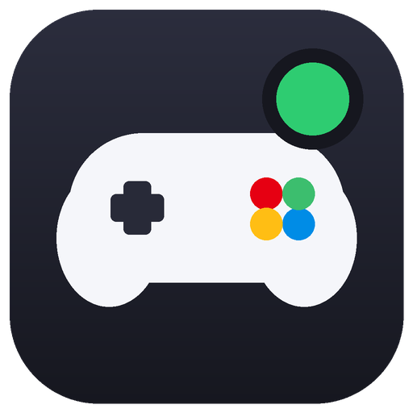

# Switch Presence

<p align="center"></p>

**English** | [Français](README.fr.md)

Show the game you're playing on your **Nintendo Switch** or **Nintendo Switch 2** right on your Discord profile.

Nintendo consoles have no native Discord integration, so Switch Presence is **manual**: you pick your game in a list, and it appears on your profile with the cover art, the console name and a session timer.

> Made by **Baptiste Shizeh**. Fan project, not affiliated with Nintendo or Discord.

## Features

- **Available in English, French and Spanish**: English by default, and you can switch anytime in Settings > General
- Choose your console: Nintendo Switch or Nintendo Switch 2
- Game list with search, favorites (★) and your own custom games
- Big cover art, console badge, session timer
- **Customize your presence** with simple switches and a live preview (timer, console name, badge, "Get this status" button)
- Built-in **Help Center** with step-by-step guides, and a quick way to contact the author
- Optional custom message (e.g. "Level 12")
- Dark and light themes
- Export / import your game list

## Quick start (Windows)

1. Download **`SwitchPresence.exe`** from the [Releases page](../../releases/latest).
2. Open the **Discord desktop app** on your PC (the browser version won't work).
3. Run `SwitchPresence.exe`, pick your console, then **double-click a game**.

That's it, your profile now shows the game. Click **Stop** to remove it. Closing the app also clears it.

### Nothing shows on Discord?

- Make sure you use the **Discord desktop app**, not the website.
- In Discord, go to **Settings > Activity Privacy** and turn on **Share my detected activity**.
- Look at your profile from another account or ask a friend: Discord sometimes displays your own activity differently.
- Covers can take a few minutes to appear after a new game is added.

### Windows shows a warning at first launch

You may see a blue "Windows protected your PC" screen. The app is not digitally signed (signing costs money). Click **More info**, then **Run anyway**. Some antivirus programs also flag any app built with PyInstaller by mistake. The full source code is in this repository, and you can [build it yourself](#build-it-yourself).

## Adding your own game

Click **+ Add a game** in the app and enter the game name. For the cover, paste a direct link to an image (ending in `.png` or `.jpg`, e.g. from Wikimedia or SteamGridDB: right-click an image > *Copy image address*); this works without any upload. If you leave it empty, a default image is shown. The game name always displays correctly.

Right-click a game to add it to favorites, change its cover, or remove it.

Want a game added for everyone, with its official cover? Use **Help > Request a game** in the app to open an issue.

## Using your own Discord application (optional)

By default the app uses the project's Discord application, with all the built-in covers. If you want your own:

1. Go to the [Discord Developer Portal](https://discord.com/developers/applications) and create an application.
2. Copy its **Application ID** (General Information tab).
3. Paste it in **Options > Settings** in the app.
4. In **Rich Presence > Art Assets**, upload two square badge images (512×512) named `badge_switch1` and `badge_switch2` (the small icon shown in the corner of the cover), plus `default_cover` (shown for games without a cover) and one image per game. The image name (without extension) is the cover key, for example `mario_kart_world`.

## Build it yourself

You need [Python 3.10+](https://www.python.org/downloads/) (tick "Add Python to PATH" when installing).

```
python -m pip install -r requirements.txt
python switch_presence.py
```

To create the `.exe`, double-click **`build.bat`**. The file appears in the `dist` folder.

## For the maintainer: publishing a release

1. Create the Discord application and upload the images (see above).
2. Paste its Application ID in `DEFAULT_CLIENT_ID` at the top of `switch_presence.py` (it is a public ID, not a secret).
3. Push a tag to build and publish the `.exe` automatically with GitHub Actions:
   ```
   git tag v1.0.0
   git push origin v1.0.0
   ```
4. **Adding games needs no new `.exe`.** The app downloads [`games.json`](games.json) from this repository at every launch (and keeps a copy for offline use). To add a game:
   1. Upload its cover in Discord Developer Portal > Rich Presence > Art Assets (`prepare_covers.py` prepares many covers at once).
   2. Add a line to `games.json` on GitHub (use the pencil icon, then *Commit changes*):
      ```json
      { "name": "Super Mario Odyssey", "cover": "super_mario_odyssey" }
      ```
   Everyone gets the new game the next time they open the app (or via **Options > Refresh game list**).
5. When you publish a new `.exe`, raise `latest_version` in `games.json`: users with an older version will see a "new version available" link in the app.

## Contact

Bug, idea or game request? Open an [issue](../../issues/new) or message me on Discord: **Shizeh**. The app has **Help > Contact the creator** too.

## Translations

The app is available in **English, French and Spanish**. Texts live in the [`locales`](locales) folder, one JSON file per language. To add a language:

1. Copy `locales/en.json` to `locales/xx.json` (`xx` = language code, e.g. `de`).
2. Translate the values (keep the keys and the `{placeholders}` unchanged) and set `"_name"` to the language's own name, e.g. `"Deutsch"`.
3. Open a pull request, or send me the file via an [issue](../../issues/new). The language then shows up automatically in **Settings > General**.

## Cover art

Game covers belong to their publishers. This repository does not distribute them: the `assets/covers/` folder is ignored by Git.

## Limitations

- The small "Playing on PlayStation" header is a native Discord feature and isn't available to custom Rich Presence. Switch Presence shows the console name under the game name instead.
- The Discord desktop app must be open.

## License

MIT. See [LICENSE](LICENSE).
